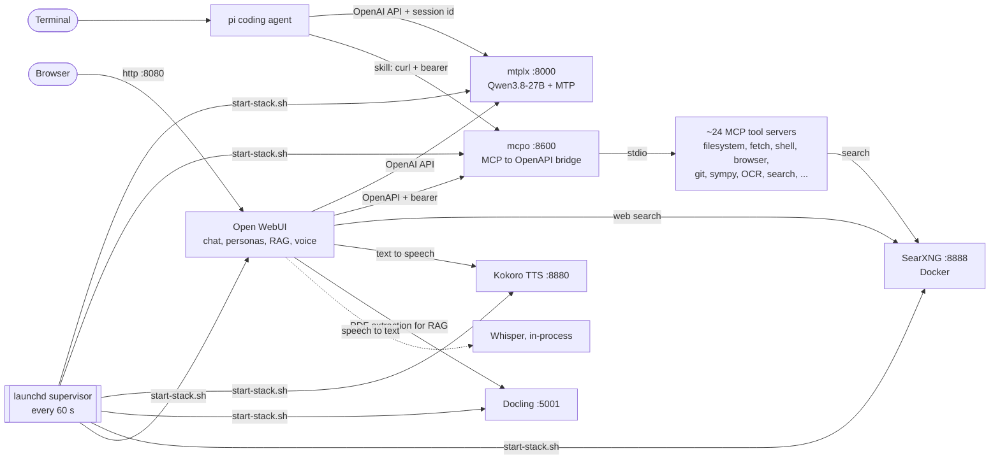

# local-ai-stack

A documented reference setup for running a private AI assistant entirely on one Apple-silicon Mac: a local 27B language model, a chat UI, about two dozen tools, voice, document parsing and web search, kept running by a small supervisor.

## Why it exists

Cloud assistants send every prompt, file and tool call off the machine. This stack keeps all of it on a MacBook Pro (M5 Pro, 64 GB): the model, the chat history, the tools and the search engine run locally and listen only on `127.0.0.1`. The hard part is not installing the pieces but making them work together on one memory-limited machine: tools the model can actually call, services that survive crashes and logouts, and a model server fast enough for daily use. This repo records how that was done, the scripts that run it, and what went wrong along the way.

It is a reference architecture and runbook, not a one-click installer.

## Architecture



All ports are defaults set in `scripts/env.sh`. Every service binds to `127.0.0.1`.

**Data flow for a chat turn:** the browser sends the message to Open WebUI, which adds the persona's system prompt, any retrieved document chunks and the schemas of the enabled tools, then calls mtplx through its OpenAI-compatible API. If the model emits a tool call, Open WebUI calls the matching mcpo endpoint (for example `POST :8600/fetch/...`) with a bearer token; mcpo forwards it over stdio to the MCP server and returns the result, and the loop repeats until the model answers.

## Features

- **Local model server.** [mtplx](https://pypi.org/project/mtplx/) serves Qwen3.8-27B with native multi-token prediction (MTP: the model drafts several tokens and verifies them in one pass). Measured 13.7 tok/s plain against 32 to 37.5 tok/s at draft depth 3 on the M5 Pro.
- **Chat front end.** [Open WebUI](https://github.com/open-webui/open-webui) with personas (system-prompt presets installed through its API), a RAG knowledge base with hybrid search and a reranker, vision, scheduled automations, and no login (single local user, loopback only).
- **Tools for the model.** [mcpo](https://github.com/open-webui/mcpo) turns stdio MCP (Model Context Protocol) servers into OpenAPI endpoints that Open WebUI registers. The running setup mounted 26 servers; `config/mcpo-config.example.json` carries 24 general-purpose ones, including two small servers written for this stack (`services/mcp/`).
- **Voice.** Speech to text with Whisper `large-v3-turbo` inside Open WebUI; text to speech through a small OpenAI-compatible wrapper around Kokoro (`services/kokoro/`).
- **Document parsing.** [Docling](https://github.com/docling-project/docling-serve) does layout-aware PDF and table extraction for RAG.
- **Private web search.** [SearXNG](https://github.com/searxng/searxng) in Docker, used by Open WebUI and by an MCP search server.
- **Coding agent on the local model.** The [pi](https://www.npmjs.com/package/@earendil-works/pi-coding-agent) terminal agent points at the same model server and reaches the tools through mcpo.
- **Supervisor.** A launchd agent runs an idempotent launcher at login and every 60 seconds; `stop-stack.sh` unloads it first so a stop sticks.
- **Observability.** `tools/mtplx-watch` shows what the model server is doing right now (prefill or decode, ETA, tok/s, last output) from its flight log, read-only.
- **Measurement.** A multiple-choice eval harness (`eval/mc_eval.py`) gates model and setting changes; raw speed benchmarks are in `eval/results/`.

## How it works

**Loopback only, and verified by reading sockets.** Every service binds `127.0.0.1`; mcpo's CORS is limited to the Open WebUI origin and it requires a bearer key. Open WebUI runs without login, which is only acceptable because nothing is reachable from the network. One service was once found on `*:5001` after a hardening pass believed it fixed (see Known limitations), so bindings are checked with `lsof`, not by reading scripts.

**Why a supervisor.** Services first started from a shell died when that shell exited, and when the shell belonged to an AI agent session they also ran at a lower scheduling priority. A launchd agent with `AbandonProcessGroup` makes launchd the parent of every service at nice 0. The launcher checks each port and starts only what is down, so the same job covers login start and crash restart. It also enforces start order: Open WebUI waits for mcpo, because it reads every tool spec on first page load.

**How tools reach the model.** Open WebUI speaks OpenAPI, not MCP, so mcpo bridges them: one process, one subpath per server, one bearer. Tool exposure is narrowed in three places: the filesystem server sees four folders instead of the home directory; the email server's destructive functions are filtered out at the Open WebUI connection (mcpo renames operations to `tool_<name>_post`, and the filter must use those names); and the shell and browser tools are off by default and enabled per chat. The coding agent has no MCP client, so it calls the same mcpo endpoints through a documented skill and a helper script, which keeps one copy of each tool server running instead of two.

**Memory on a 64 GB machine.** The 27B model peaks around 42 GB in benchmarks and a large turn reached 62.6 GB, so everything else competes for the remainder. The scheduler is serial (one request at a time), Docker's VM reserved about 8 GB for one small container, and 26 resident tool servers kept swap high. The speed audit found that the largest real-world slowdown was other heavy work on the same machine (median 23.4 tok/s in use against 37.5 idle), not configuration. Details in `docs/performance.md`.

**Observability and the cache stall.** mtplx writes a flight log and a per-request forensic log. Reading them found that long Open WebUI agent chats (about 190k tokens) re-read about 188k tokens before every tool step, 21 to 25 minutes each, because the session exceeded the per-session cache cap and the web UI did not identify itself the way the server requires to keep a session's cache live between tool turns. The terminal coding agent does, so long agent work moved there. Full write-up in `docs/lessons-learned.md`.

**Large tool calls.** mtplx's default guard silently drops a streamed tool call over 2,048 tokens, which made an agent "write" files that never appeared. The launcher raises the guard to the full context window.

## Quick start

Requirements: an Apple-silicon Mac with enough unified memory for the model (built on 64 GB), Homebrew, [uv](https://docs.astral.sh/uv/), Node.js (for `npx` tool servers), Docker Desktop (for SearXNG), and about 16 GB of disk for the model plus room for its on-disk cache.

1. **Pick a runtime folder.** The scripts default to `STACK_HOME=~/AI`. Create `mtplx/`, `open-webui/`, `mcp/`, `kokoro/` and `searxng/` inside it.
2. **Install the services** (each into its own venv or tool install): `mtplx` into `$STACK_HOME/mtplx/.venv`, `open-webui` into `$STACK_HOME/open-webui/.venv`, `uv tool install mcpo`, `uv tool install docling-serve`, and Kokoro's dependencies from `services/kokoro/requirements.txt` into `$STACK_HOME/kokoro/.venv` with `kokoro-v1.0.onnx` and `voices-v1.0.bin` beside it.
3. **Download the model,** for example `hf download Youssofal/Qwen3.8-27B-MTPLX-Optimized-Speed`.
4. **Configure.** Copy `config/stack.env.example` to `$STACK_HOME/stack.env` and set `MTPLX_MODEL`. Copy `config/mcpo-config.example.json` to `$STACK_HOME/mcp/mcpo-config.json` and replace every `YOUR_USER`, `/PATH/TO/...` and token placeholder; delete servers you do not want. Create the bearer: `umask 077; openssl rand -hex 23 > $STACK_HOME/mcp/.bearer`. Copy `config/searxng-settings.example.yml` to `$STACK_HOME/searxng/settings.yml`, set a secret, and create the container (command in `docs/runbook.md`).
5. **Start once by hand** from a plain terminal: `scripts/start-stack.sh`, then open http://127.0.0.1:8080.
6. **Wire Open WebUI** (Admin settings): add each tool server as `http://127.0.0.1:8600/<name>` with the bearer; set text to speech to OpenAI-compatible at `http://127.0.0.1:8880/v1`; set document extraction to Docling at `http://127.0.0.1:5001`; set web search to SearXNG. Optionally install the functions in `owui-functions/` with `scripts/install-owui-function.sh`.
7. **Hand it to the supervisor.** Copy `config/com.example.ai-stack.plist.example` to `~/Library/LaunchAgents/com.example.ai-stack.plist`, fix the paths, run `scripts/stop-stack.sh` to clear the hand-started processes, then `launchctl bootstrap gui/$(id -u) ~/Library/LaunchAgents/com.example.ai-stack.plist`.

Day-to-day operation, health checks, upgrades and backups: `docs/runbook.md`.

## Project structure

```
scripts/
  env.sh                    shared settings: STACK_HOME, ports, PATH; sources $STACK_HOME/stack.env
  start-stack.sh            idempotent launcher, run by the supervisor every 60 s
  stop-stack.sh             unloads the supervisor, then stops every service
  backup.sh                 WAL-safe Open WebUI DB copy + tool config + launchers, keeps 10
  start-mtplx.sh            model server flags, raised tool-call guard
  start-mcpo.sh             MCP to OpenAPI bridge, loopback, CORS, bearer
  start-webui.sh            Open WebUI env (no telemetry, no login, pinned cwd)
  start-kokoro.sh           TTS server
  start-docling.sh          document extraction, loopback
  start-taskmodel.sh        optional small second model (not started by default)
  install-owui-function.sh  install or update an Open WebUI Function
config/                     example configs, placeholders only
services/kokoro/            OpenAI-compatible TTS wrapper around Kokoro ONNX
services/mcp/               shell-mcp.py (opt-in shell tool), osv-scanner/ (dependency audit tool)
owui-functions/             LaTeX delimiter filter, multiple-choice consensus pipe
eval/                       eval harness and raw speed benchmark results
tools/mtplx-watch           read-only live view of the model server
docs/                       runbook, lessons learned, performance notes
```

## Status and known limitations

Built in August 2026 and in regular use through September 2026. This repo documents that setup as built; it is a snapshot, not a maintained product, and has not been tested on any other machine.

- **One service was bound to all interfaces.** Docling listened on `*:5001` because the stack called a second launcher without `--host 127.0.0.1`. The fix in this repo is a single launcher per service in `scripts/`, with Docling bound to loopback.
- **Serial scheduler.** One request at a time: the web UI, the coding agent and any script queue behind each other.
- **Memory pressure** is chronic at 64 GB with the full tool roster; the server's on-disk KV session bank is uncapped by default and grew past 100 GB (`MTPLX_SESSION_BANK_MAX_BYTES` caps it).
- **Long agent chats in Open WebUI stall** on re-prefill near 190k tokens; the server-side fixes were not applied. Use shorter chats or the coding agent.
- **The shell tool has no allow or deny list,** only timeout and output caps; it is opt-in per chat.
- **The SearXNG create command is reconstructed,** not copied from a working `docker inspect`.
- **Staged, never activated:** the small task model and the consensus pipe (mock-tested only).
- **The eval harness** was only smoke-tested on one item in the original setup.
- **Personas, prompts and knowledge bases** are not included; they were tied to personal projects. Several tool servers in the real roster were too, and are left out of the example config.
- **Related tool servers published separately:** `mcp-worldmonitor`, `mcp-twelvedata`, `mcp-yfinance`.

## How this was built

Ryan Wisth designed and ran this stack by directing AI coding agents (Claude Code). He set the goals, the constraints (local only, loopback only, survives reboots) and the acceptance checks, and verified results on the machine; the agents wrote most of the scripts and glue code and did the log forensics under that direction. The incidents in `docs/lessons-learned.md` are the record of that process.

## License

MIT, see `LICENSE`. Third-party projects named here (mtplx, Open WebUI, mcpo, Kokoro, Docling, SearXNG, pi, Qwen and the listed MCP servers) belong to their authors and are not included. Not affiliated with any of them or with Apple.
